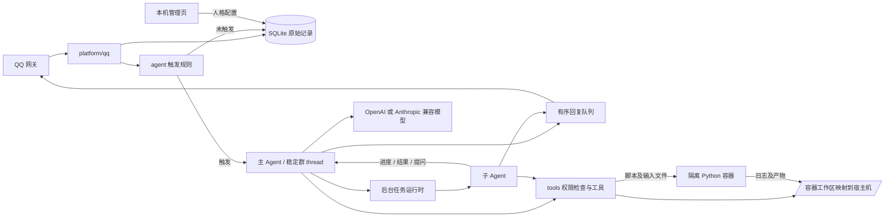

# 架构与边界

`platform/qq` 管理扫码凭据、网关连接、事件归一化和 QQ 发送；凭据位于 SQLite，正常重启自动读取。`agent` 管理触发规则、每群串行执行、模型上下文和异步任务；一个群对应一个稳定 thread。`storage` 保存原始消息、摘要、长期记忆、任务和发送状态，原始记录独立于 checkpoint。`delivery` 排队发送文字与媒体，记录失败和结果未知的发送。`tools` 定义能力、权限声明、工作区和插件；`models` 适配兼容接口与模型上下文预算。`startup` 负责自检与恢复，`cli` 提供自检和历史导出。

收到群消息后先入库、去重，再判断 @ 或显式配置的关键词；默认只在 @ 时触发。未触发的消息不调用模型和工具。触发时读取有限的近期原文、摘要和长期记忆，答复后按预算后台整理摘要；原始消息始终独立保留。每轮清空模型检查点中的旧消息，群线程 ID 不变，历史通过数据库按需获取。后台任务使用持久化状态，进度和完成结果可回到主 Agent；子 Agent 也可通过同一发送队列交付文件。

## 容器权限

主进程及其媒体子进程运行在机器人 Docker 容器内，使用非 root 用户、只读根文件系统、默认容器安全配置、`cap_drop: ALL`、`no-new-privileges` 和进程数限制。项目没有挂载 Docker socket，也没有给容器特权模式。`/data` 和 `/workspace` 分别映射到宿主机数据及工作区目录，`/tmp` 是临时目录。`/app/config`、模型配置文件和 `/app/plugins` 只读。

Python 脚本在独立的受限容器运行，不挂载机器人数据库、凭据或宿主机工作区。机器人显式复制当前会话的脚本和输入，执行后校验并写回产物；脚本不能直接联网或启动子进程。管理页面只允许本机来源写入 SQLite 人格配置，主 Agent 下一回合读取。

每个工具都声明需要的 `network`、`process`、`workspaceRead`、`workspaceWrite` 能力；被配置禁止的能力使该工具不注册。Deep Agents 文件工具还应用工作区读写规则。这里的 `network` 控制本项目的外部联网工具，不关闭 QQ 和模型必需的容器网络。插件是可信的同进程代码，权限声明不是对恶意插件的操作系统隔离。内建命令和插件也不能被当成独立容器：它们继承机器人容器用户、网络、工作区和数据卷访问权限。

每个群的文件根目录是 `/workspace/<群标识哈希>/`，宿主机对应 `BOT_WORKSPACE_HOST/<群标识哈希>/`。可交付文件须落在当前群目录；发送前会检查真实路径，拒绝越过群工作区的文件。数据库和 QQ 凭据不放在工作区。

## 启动与恢复

启动检查覆盖配置、数据库读写、QQ SDK、工具注册、checkpoint、媒体命令、Python 执行与中文字体、已启用插件、搜索和模型工具调用；开启视觉时还检查图片输入。QQ 可独立连接和记账，其他依赖未就绪时不标记为 `ready`，自检会自动重试。首次绑定和凭据失效时需要用户扫码；正常网络断线由 QQ SDK 重连。

配置文件按新回合读取；模型 `.env` 作为只读文件挂载并重读，挂载源发生原子替换时可能需要重新创建容器。Docker 挂载路径或权限自身的改变也需要重新创建容器。语音先保持关闭，等待后续方案。
